# Database Schema

PostgreSQL 16, accessed through the Django ORM. Every table is owned by one Django app (shown in brackets).
Revision 2 (2026-11-11): adds product variants, seller shipping methods, GST, COD, returns, a seller ledger and ad slots, and removes coupons. See §7 for the changes.

## 0. Conventions

| Topic | Rule |
|-------|------|
| Primary keys | `id BIGINT GENERATED BY DEFAULT AS IDENTITY` (Django `BigAutoField`) |
| Public identifiers | Orders, sub-orders, returns, invoices and settlements also have human-readable unique numbers (`KTV-26111-8F3K2Q`). Products and stores use slugs. Internal ids are never the only guard: every access is permission-scoped |
| Timestamps | `created_at`, `updated_at` as `TIMESTAMPTZ` (UTC) on every table, from the abstract `TimeStampedModel` |
| Money | `NUMERIC(12,2)` in INR. Converted to integer paise only inside the Razorpay adapter |
| Rates | `NUMERIC(5,2)` percent (GST, commission, TCS/TDS) |
| Enums | `VARCHAR` + Django `TextChoices` + a DB `CHECK` constraint |
| Case-insensitive unique | `email` and store `name` use a unique index on `LOWER(col)` |
| FK delete rules | `PROTECT` for anything referenced by money, tax or order history. `CASCADE` only for pure children (images, cart items) |
| Soft delete | Products and variants (`deleted_at` / `is_active`). Users are deactivated, never deleted |
| Extensions | `pg_trgm` (fuzzy search), `btree_gin` |

## 1. Requirement → table mapping

| Brief entity / client answer | Table(s) | Note |
|------------------------------|----------|------|
| Users | `users` | |
| Buyer profiles | *merged into* `users` | Buyers have no extra data (AD-5) |
| Seller profiles | `seller_profiles` | Private business, GST, KYC and bank data |
| Stores | `stores` | Public storefront, 1:1 with seller |
| Seller approval requests | *state on* `seller_profiles` + `audit_logs` | AD-6 |
| Categories + subcategories | `categories` (tree) | AD-4 |
| Products | `products` | Shared content: name, description, category, GST/HSN |
| **Product variants** (client: yes) | `product_variants` | Sellable unit: SKU, price, stock, attributes. Simple products have one default variant |
| Product images | `product_images` | Optionally tied to a variant (e.g. colour) |
| Product inventory | `product_variants.stock_quantity` + `inventory_movements` ledger | |
| **Seller-defined delivery** (client: each vendor ships their own way) | `shipping_methods` | Each store defines its own methods, fees, ETAs, pincodes and COD support |
| Shopping carts / items | `carts`, `cart_items` | Lines reference variants |
| Customer addresses | `addresses` | Orders snapshot them |
| Orders / Seller suborders / Order items | `orders`, `seller_orders`, `order_items` | GST split per line |
| — | `order_status_history` | Timeline |
| Payments / Payment transactions | `payments`, `payment_events` | Online payments. COD is tracked on sub-orders |
| Refunds | `refunds` | Gateway or manual bank refunds |
| **Returns** (client: yes) | `return_requests`, `return_items` | |
| **GST invoices** (client: GST is a must) | `tax_documents`, `document_sequences` | Seller sales invoices, credit notes, platform commission invoices |
| Marketplace commissions | `commission_rules` | Amounts snapshotted on lines |
| Seller settlements | `seller_ledger_entries`, `seller_settlements` | A ledger handles COD, refunds, TCS/TDS, ad charges and negative balances |
| Product reviews | `reviews` | |
| Notifications | `notifications` | |
| ~~Coupons~~ | — | **Dropped** (client: no coupons) |
| Homepage banners → **ad spaces** (client: ads for income) | `ad_slots`, `advertisements`, `ad_daily_stats` | One system for house banners, paid banners, carousels and sponsored products |
| — | `platform_settings`, `audit_logs` | |
| — | JWT blacklist tables | From `djangorestframework-simplejwt` |

## 2. Tables

### 2.1 `users` [accounts]

| Column | Type | Constraints |
|--------|------|-------------|
| id | BIGINT | PK |
| email | VARCHAR(254) | NOT NULL, unique on `LOWER(email)` |
| password | VARCHAR(128) | Argon2 hash |
| first_name / last_name | VARCHAR(80) | first_name NOT NULL |
| phone | VARCHAR(15) | E.164 (`+91XXXXXXXXXX`) |
| phone_verified_at | TIMESTAMPTZ | nullable (used for COD eligibility once SMS OTP is added) |
| role | VARCHAR(10) | CHECK IN (`buyer`,`seller`,`admin`), default `buyer` |
| avatar_key / avatar_url | VARCHAR | nullable |
| is_active / is_staff / is_superuser | BOOLEAN | |
| email_verified_at | TIMESTAMPTZ | |
| cod_blocked | BOOLEAN | default false. Set by an admin after repeated COD refusals |
| last_login, date_joined | TIMESTAMPTZ | |

Indexes: `LOWER(email)` unique, `(role, date_joined DESC)`. `role` is writable only by the server.

### 2.2 `addresses` [accounts]

`id`, `user_id` (FK CASCADE), `full_name`, `phone`, `line1`, `line2`, `landmark`, `city`, `state` (validated against the list of Indian states/UTs, and also stored as a **GST state code** `CHAR(2)`, e.g. `33` for Tamil Nadu), `pincode CHAR(6)` CHECK `^[1-9][0-9]{5}$`, `country` default `IN`, `address_type` (`home`/`work`/`other`), `is_default`.
Indexes: `(user_id)`, **partial unique** `(user_id) WHERE is_default`.

### 2.3 `seller_profiles` [sellers]

| Column | Type | Constraints |
|--------|------|-------------|
| id | BIGINT | PK |
| user_id | BIGINT | FK → users PROTECT, UNIQUE |
| legal_business_name | VARCHAR(200) | NOT NULL (must match the GST registration) |
| trade_name | VARCHAR(200) | |
| business_type | VARCHAR(20) | CHECK IN (`proprietorship`,`partnership`,`llp`,`private_ltd`,`public_ltd`,`other`) |
| gstin | VARCHAR(15) | **NOT NULL, UNIQUE**, format and checksum validated |
| gst_state_code | CHAR(2) | derived from the GSTIN (first 2 digits) |
| pan | VARCHAR(10) | NOT NULL. Must equal characters 3–12 of the GSTIN |
| registered_address_* | VARCHAR | line1, line2, city, state, pincode |
| pickup_address_* | VARCHAR | Ship-from address. **Its state decides CGST+SGST vs IGST** |
| bank_account_holder | VARCHAR(120) | |
| bank_account_number_enc | TEXT | Fernet-encrypted |
| bank_account_last4 | CHAR(4) | |
| bank_ifsc | VARCHAR(11) | |
| gst_certificate_key / cancelled_cheque_key | VARCHAR(255) | private storage |
| status | VARCHAR(12) | CHECK IN (`draft`,`pending`,`approved`,`rejected`,`suspended`) |
| submitted_at, reviewed_at, reviewed_by_id | | |
| rejection_reason / suspension_reason | TEXT | |

Index `(status, submitted_at)`.

### 2.4 `stores` [sellers]

`id`, `seller_id` (FK → seller_profiles PROTECT, UNIQUE), `name` (unique on `LOWER(name)`), `slug` UNIQUE, `description`, `logo_key/url`, `banner_key/url`, `support_email`, `support_phone`, `return_policy` TEXT (shown on the PDP), `accepts_returns` BOOLEAN default true, `is_featured`, `avg_rating NUMERIC(3,2)`, `rating_count`.
Public only if `seller_profiles.status='approved'`.

### 2.5 `shipping_methods` [sellers]: each seller ships their own way

| Column | Type | Constraints |
|--------|------|-------------|
| id | BIGINT | PK |
| store_id | BIGINT | FK → stores CASCADE |
| name | VARCHAR(60) | Shown to buyer, e.g. "Standard courier", "Same-day local delivery" |
| method_type | VARCHAR(16) | CHECK IN (`standard`,`express`,`local_delivery`,`store_pickup`) |
| fee | NUMERIC(10,2) | ≥ 0, charged once per sub-order |
| free_above | NUMERIC(12,2) | nullable. Fee is waived when the sub-order item subtotal ≥ this value |
| min_days / max_days | SMALLINT | delivery estimate. CHECK `max_days >= min_days` |
| serviceable_pincodes | TEXT[] | empty = all India. Entries can be full pincodes (`600001`) or prefixes (`600`) |
| cod_allowed | BOOLEAN | the seller collects cash on delivery with this method |
| is_active | BOOLEAN | |
| sort_order | SMALLINT | |

Constraints: `UNIQUE(store_id, name)`. Index `(store_id, is_active)`, GIN on `serviceable_pincodes`.
Rule: an approved store must have ≥ 1 active method before its products can be published. `store_pickup` shows the store's pickup address and needs no delivery pincode match.

### 2.6 `categories` [catalog]

`id`, `parent_id` (self FK PROTECT, nullable), `name`, `slug` UNIQUE, `description`, `image_key/url`, `depth` (CHECK 0..2), `sort_order`, `is_active`,
`variant_attributes JSONB` (suggested attribute names for products in this leaf, e.g. `["Size","Colour"]`, used by the seller form and storefront filters),
`default_hsn_code VARCHAR(8)` and `default_gst_rate NUMERIC(5,2)` (pre-fill only, the seller confirms), `return_window_days SMALLINT` nullable (category override, e.g. 0 for innerwear).
Constraints: `UNIQUE(parent_id, name)`. Products reference **leaf** categories only.

### 2.7 `products` [catalog]: shared content of a product

| Column | Type | Constraints |
|--------|------|-------------|
| id | BIGINT | PK |
| store_id | BIGINT | FK → stores PROTECT |
| category_id | BIGINT | FK → categories PROTECT (leaf) |
| name | VARCHAR(200) | |
| slug | VARCHAR(220) | UNIQUE |
| brand | VARCHAR(100) | |
| description | TEXT | sanitised on render |
| specifications | JSONB | `[{"name","value"}]`, ≤ 30 |
| variant_options | JSONB | ordered option definitions, e.g. `[{"name":"Colour","values":["Black","Blue"]},{"name":"Size","values":["S","M","L"]}]`. Empty list = simple product |
| hsn_code | VARCHAR(8) | NOT NULL, 4–8 digits |
| gst_rate | NUMERIC(5,2) | NOT NULL. Must be in `platform_settings.gst_rate_choices` |
| is_returnable | BOOLEAN | default true |
| status | VARCHAR(16) | CHECK IN (`draft`,`pending_review`,`active`,`rejected`,`inactive`) |
| rejection_reason | TEXT | |
| is_featured | BOOLEAN | |
| min_price / max_price | NUMERIC(12,2) | denormalised from active variants (listing filter and sort) |
| total_stock | INTEGER | denormalised sum (fast "in stock" filter) |
| avg_rating / review_count / sold_count | | denormalised |
| search_vector | TSVECTOR | name A, brand B, category B, variant values B, description C |
| published_at / deleted_at | TIMESTAMPTZ | |

Indexes: `GIN(search_vector)`, `GIN(name gin_trgm_ops)`, `(store_id, status)`, and partial `WHERE status='active' AND deleted_at IS NULL` indexes on `(category_id, min_price)`, `(category_id, created_at DESC)` and `(category_id, sold_count DESC)`.

### 2.8 `product_variants` [catalog]: the sellable unit

| Column | Type | Constraints |
|--------|------|-------------|
| id | BIGINT | PK |
| product_id | BIGINT | FK → products CASCADE |
| store_id | BIGINT | FK → stores PROTECT (denormalised from the product for the SKU constraint and fast isolation) |
| sku | VARCHAR(64) | `UNIQUE(store_id, sku)` |
| attributes | JSONB | `{"Colour":"Black","Size":"M"}`. Keys and values must exist in `products.variant_options`. `{}` for a simple product |
| mrp | NUMERIC(12,2) | CHECK `> 0` |
| price | NUMERIC(12,2) | CHECK `price > 0 AND price <= mrp`. **GST-inclusive** |
| stock_quantity | INTEGER | **CHECK `>= 0`** |
| low_stock_threshold | INTEGER | default 5 |
| max_per_order | SMALLINT | default 10 |
| weight_grams | INTEGER | nullable (future courier integration) |
| is_default | BOOLEAN | the variant preselected on the PDP |
| is_active | BOOLEAN | |

Constraints: `UNIQUE(product_id, attributes)`, partial unique `(product_id) WHERE is_default`.
Indexes: `(product_id)`, `GIN(attributes jsonb_path_ops)` for catalogue filters like Colour=Black.

### 2.9 `product_images` [catalog]

`id`, `product_id` (FK CASCADE), `variant_id` (FK → product_variants SET NULL, nullable; when set, the image shows for that variant, typically per colour), `storage_key`, `url` (derived cache, rebuildable from `storage_key`), `width`, `height`, `alt_text`, `sort_order`, `is_primary`.
Partial unique `(product_id) WHERE is_primary`. Max 8 per product + 4 per variant.

### 2.10 `inventory_movements` [catalog]

`id`, `variant_id` (FK PROTECT), `delta` (CHECK ≠ 0), `stock_after` (CHECK ≥ 0), `reason` CHECK IN (`initial`,`manual_adjustment`,`order_reserved`,`order_released`,`order_cancelled`,`return_restock`), `seller_order_id` (FK SET NULL), `return_request_id` (FK SET NULL), `actor_id` (FK SET NULL), `note`, `created_at`.
Index `(variant_id, created_at DESC)`.

### 2.11 `carts` / `cart_items` [cart]

`carts`: `id`, `user_id` UNIQUE.
`cart_items`: `id`, `cart_id` (FK CASCADE), `variant_id` (FK CASCADE), `quantity` CHECK 1..99, `price_when_added` (display only). `UNIQUE(cart_id, variant_id)`.
The chosen shipping method per store is **not** stored in the cart. It is picked at checkout.

### 2.12 `orders` [orders]

| Column | Type | Constraints |
|--------|------|-------------|
| id | BIGINT | PK |
| order_number | VARCHAR(24) | UNIQUE |
| user_id | BIGINT | FK → users PROTECT |
| payment_method | VARCHAR(8) | CHECK IN (`online`,`cod`) |
| status | VARCHAR(16) | CHECK IN (`pending_payment`,`confirmed`,`completed`,`cancelled`,`payment_failed`,`expired`) |
| payment_status | VARCHAR(20) | CHECK IN (`pending`,`paid`,`cod_pending`,`cod_partially_collected`,`cod_collected`,`failed`,`partially_refunded`,`refunded`) |
| shipping_address | JSONB | snapshot incl. `gst_state_code` |
| billing_gstin | VARCHAR(15) | nullable. Buyer's GSTIN for a B2B invoice (input tax credit) |
| items_subtotal / shipping_total / cod_fee_total / grand_total | NUMERIC(12,2) | CHECK `grand_total = items_subtotal + shipping_total + cod_fee_total`, `> 0` |
| tax_total | NUMERIC(12,2) | informational. Prices are tax-inclusive |
| idempotency_key | UUID | `UNIQUE(user_id, idempotency_key)` |
| expires_at | TIMESTAMPTZ | online only |
| confirmed_at | TIMESTAMPTZ | |

COD orders are created directly as `confirmed` / `cod_pending` (no payment step).
Indexes: `(user_id, created_at DESC)`, `(status, created_at DESC)`, partial `(expires_at) WHERE status='pending_payment'`.

### 2.13 `seller_orders` [orders]

| Column | Type | Constraints |
|--------|------|-------------|
| id | BIGINT | PK |
| order_id | BIGINT | FK → orders PROTECT |
| store_id | BIGINT | FK → stores PROTECT |
| sub_order_number | VARCHAR(28) | UNIQUE |
| status | VARCHAR(16) | CHECK IN (`pending`,`confirmed`,`processing`,`shipped`,`delivered`,`cancelled`,`undelivered`) |
| shipping_method_id | BIGINT | FK → shipping_methods SET NULL |
| shipping_method_snapshot | JSONB | name, type, fee, min/max days |
| items_subtotal / shipping_fee / cod_fee | NUMERIC(12,2) | |
| total | NUMERIC(12,2) | CHECK `= items_subtotal + shipping_fee + cod_fee` |
| is_interstate | BOOLEAN | seller pickup state ≠ buyer state → IGST |
| tax_total | NUMERIC(12,2) | sum of line GST + shipping GST |
| commission_amount | NUMERIC(12,2) | |
| cod_amount | NUMERIC(12,2) | = `total` for COD, else 0 |
| cod_collected_at | TIMESTAMPTZ | set when the seller marks delivered (COD) |
| refunded_amount | NUMERIC(12,2) | CHECK `<= total` |
| carrier / tracking_number / tracking_url | VARCHAR | carrier + tracking required for `shipped`, unless local_delivery/store_pickup |
| expected_delivery_date | DATE | |
| shipped_at / delivered_at / cancelled_at | TIMESTAMPTZ | |
| cancelled_by / cancellation_reason | | |
| return_window_ends_at | TIMESTAMPTZ | `delivered_at` + effective return window |
| ledger_posted_at | TIMESTAMPTZ | when entries were written to the seller ledger |

Constraints: `UNIQUE(order_id, store_id)`. Indexes: `(store_id, status, created_at DESC)`, partial `(return_window_ends_at) WHERE status='delivered' AND ledger_posted_at IS NULL`.
`undelivered` = the COD buyer refused or the courier could not deliver. Stock goes back to inventory, and repeated refusals can set `users.cod_blocked`.

### 2.14 `order_items` [orders]

| Column | Type | Constraints |
|--------|------|-------------|
| id | BIGINT | PK |
| seller_order_id | BIGINT | FK → seller_orders CASCADE |
| variant_id | BIGINT | FK → product_variants PROTECT |
| product_id | BIGINT | FK → products PROTECT (for reviews and reports) |
| product_name / variant_label / sku / image_key / image_url | VARCHAR | snapshot (`variant_label` = "Black / M"). `image_key` is provider-neutral so media can move storage (AWS_MIGRATION P4) |
| hsn_code | VARCHAR(8) | snapshot |
| gst_rate | NUMERIC(5,2) | snapshot |
| unit_mrp / unit_price | NUMERIC(12,2) | tax-inclusive |
| quantity | SMALLINT | CHECK > 0 |
| line_total | NUMERIC(12,2) | `unit_price × quantity` |
| taxable_value | NUMERIC(12,2) | `line_total / (1 + gst_rate/100)`, rounded |
| cgst_amount / sgst_amount / igst_amount | NUMERIC(12,2) | either CGST+SGST (intra-state) or IGST (inter-state). CHECK `taxable_value + cgst + sgst + igst = line_total` |
| commission_rate / commission_amount | | snapshot |
| returned_quantity | SMALLINT | default 0, CHECK `<= quantity` |
| is_returnable / return_window_days | | snapshot |

Constraints: `UNIQUE(seller_order_id, variant_id)`. Indexes `(variant_id)`, `(product_id)`.

### 2.15 `order_status_history` [orders]

`id`, `order_id`, `seller_order_id` (nullable), `return_request_id` (nullable), `from_status`, `to_status`, `changed_by_id`, `note`, `created_at`. Index `(order_id, created_at)`.

### 2.16 `payments` [payments]: online payments only

`id`, `order_id` (FK PROTECT), `gateway` (`razorpay`/`mock`), `gateway_order_id` UNIQUE, `gateway_payment_id` UNIQUE nullable, `amount` (> 0), `amount_refunded` (CHECK ≤ amount), `currency`, `status` CHECK IN (`created`,`captured`,`failed`,`partially_refunded`,`refunded`), `method` (`upi`/`card`/`netbanking`/`wallet`/`emi`/`paylater`, from the gateway), `failure_code`, `failure_reason`, `signature_verified`, `captured_at`.
Partial unique `(order_id) WHERE status IN ('captured','partially_refunded','refunded')`. Index `(status, created_at)`.
Never stored: card number, CVV, UPI PIN.

### 2.17 `payment_events` [payments]

`id`, `payment_id` (nullable), `source` (`webhook`/`callback`/`reconcile`), `gateway_event_id` UNIQUE (nullable), `event_type`, `payload JSONB`, `signature_valid`, `processed_at`, `processing_error`, `received_at`.

### 2.18 `refunds` [payments]

| Column | Type | Constraints |
|--------|------|-------------|
| id | BIGINT | PK |
| order_id | BIGINT | FK → orders PROTECT |
| payment_id | BIGINT | FK → payments PROTECT, **nullable** (null for COD refunds) |
| seller_order_id | BIGINT | FK → seller_orders PROTECT, nullable |
| return_request_id | BIGINT | FK → return_requests PROTECT, nullable |
| amount | NUMERIC(12,2) | > 0 |
| method | VARCHAR(16) | CHECK IN (`gateway`,`bank_transfer`) (COD refunds go out by bank or UPI transfer) |
| payout_details_enc | TEXT | encrypted buyer UPI ID or bank details (COD refunds only) |
| reason | VARCHAR(30) | `buyer_cancelled`/`seller_cancelled`/`admin`/`late_capture`/`return` |
| status | VARCHAR(12) | CHECK IN (`pending`,`processed`,`failed`) |
| gateway_refund_id | VARCHAR(64) | UNIQUE nullable |
| manual_reference | VARCHAR(64) | UTR for bank transfers |
| initiated_by_id / processed_at | | |

CHECK `(method='gateway') = (payment_id IS NOT NULL)`. The service enforces Σ refunds ≤ amount paid for that sub-order, under a row lock.

### 2.19 `return_requests` / `return_items` [orders]

`return_requests`:

| Column | Type | Constraints |
|--------|------|-------------|
| id | BIGINT | PK |
| return_number | VARCHAR(28) | UNIQUE |
| seller_order_id | BIGINT | FK → seller_orders PROTECT |
| user_id | BIGINT | FK → users PROTECT |
| reason_code | VARCHAR(20) | CHECK IN (`damaged`,`defective`,`wrong_item`,`not_as_described`,`size_fit`,`changed_mind`,`other`) |
| description | TEXT | |
| photo_keys | JSONB | up to 5 image keys |
| status | VARCHAR(16) | CHECK IN (`requested`,`approved`,`rejected`,`in_transit`,`received`,`refunded`,`closed`,`cancelled`) |
| resolution | VARCHAR(10) | `refund` (MVP). `replacement` reserved |
| refund_amount | NUMERIC(12,2) | computed from items (shipping excluded unless the reason is damaged, defective or wrong item) |
| return_tracking | VARCHAR(100) | |
| seller_note / rejection_reason | TEXT | |
| decided_by_id / decided_at / received_at | | |
| escalated_to_admin | BOOLEAN | buyer can escalate a rejection |

`return_items`: `id`, `return_request_id` (FK CASCADE), `order_item_id` (FK PROTECT), `quantity` (> 0), `restock` BOOLEAN. `UNIQUE(return_request_id, order_item_id)`. The service checks `quantity ≤ order_items.quantity − returned_quantity`.
Indexes: `(seller_order_id)`, `(user_id, created_at DESC)`, `(status)`.

### 2.20 `tax_documents` / `document_sequences` [invoicing]

`tax_documents`:

| Column | Type | Constraints |
|--------|------|-------------|
| id | BIGINT | PK |
| doc_type | VARCHAR(20) | CHECK IN (`sales_invoice`,`credit_note`,`commission_invoice`) |
| document_number | VARCHAR(16) | GST rule: ≤ 16 chars, unique per issuer per financial year |
| issuer_type | VARCHAR(10) | `seller` / `platform` |
| issuer_store_id | BIGINT | FK → stores PROTECT, nullable (null = platform) |
| financial_year | CHAR(7) | `2026-27` |
| seller_order_id | BIGINT | FK, nullable (sales invoice / credit note) |
| return_request_id | BIGINT | FK, nullable (credit note) |
| settlement_id | BIGINT | FK, nullable (commission invoice) |
| issuer_gstin / recipient_gstin | VARCHAR(15) | snapshot |
| place_of_supply | CHAR(2) | state code |
| taxable_value / cgst / sgst / igst / total | NUMERIC(12,2) | |
| lines | JSONB | frozen line breakdown |
| pdf_key | VARCHAR(255) | private storage |
| issued_at | TIMESTAMPTZ | |

Constraints: `UNIQUE(issuer_type, issuer_store_id, financial_year, document_number)` (NULLS NOT DISTINCT).
`document_sequences`: `id`, `issuer_type`, `issuer_store_id`, `doc_type`, `financial_year`, `prefix`, `last_number`, `UNIQUE(issuer_type, issuer_store_id, doc_type, financial_year)`. Locked with `SELECT … FOR UPDATE` when issuing, so numbering has no gaps and no duplicates.
When documents are issued: sales invoice when a sub-order is **shipped**, credit note when a return is refunded, commission invoice when a settlement is approved.

### 2.21 `commission_rules` [settlements]

Unchanged from rev 1: `scope` (`global`/`category`/`store`), `category_id`, `store_id`, `rate_percent` 0..100, `is_active`, `created_by_id`. Scope-consistency CHECK, and partial uniques so each scope has only one active rule. Resolution order: store → category (walking up its ancestors) → global.
Commission is calculated on the **item value incl. GST** (line_total), not on shipping. The platform charges GST on its commission (`platform_settings.commission_gst_rate`, 18%).

### 2.22 `seller_ledger_entries` [settlements]: money owed to or by each seller

| Column | Type | Constraints |
|--------|------|-------------|
| id | BIGINT | PK |
| store_id | BIGINT | FK → stores PROTECT |
| entry_type | VARCHAR(24) | CHECK IN (`sale`,`shipping`,`commission`,`commission_gst`,`tcs`,`tds`,`cod_collected_by_seller`,`refund`,`ad_charge`,`payout`,`adjustment`) |
| amount | NUMERIC(12,2) | **signed**: + = platform owes the seller, − = the seller owes the platform. CHECK `amount <> 0` |
| seller_order_id / return_request_id / advertisement_id / settlement_id | BIGINT | FKs, nullable |
| description | VARCHAR(255) | |
| created_by_id | BIGINT | nullable (null = system) |
| created_at | TIMESTAMPTZ | |

Append-only. Indexes: `(store_id, created_at)`, partial `(store_id) WHERE settlement_id IS NULL`.

Example, delivered **online** sub-order of ₹1,180 (items ₹1,100 + shipping ₹80), 10% commission:
`sale +1100`, `shipping +80`, `commission −110`, `commission_gst −19.80`, `tcs −x`, `tds −y` → seller is owed the net.
Same sub-order paid by **COD**: same entries **plus** `cod_collected_by_seller −1180` (the seller already has the cash) → net is negative, so the seller owes commission and taxes. This is offset against prepaid sales in the same settlement, or carried forward.

### 2.23 `seller_settlements` [settlements]

`id`, `settlement_number` UNIQUE, `store_id`, `period_end DATE`, `opening_balance`, `total_credits`, `total_debits`, `net_amount` (CHECK `= opening_balance + total_credits + total_debits`), `status` CHECK IN (`draft`,`approved`,`paid`,`carried_forward`,`cancelled`), `payment_reference` (UTR), `paid_at`, `created_by_id`, `paid_by_id`, `notes`.
A positive net is paid out (a `payout` ledger entry is written). A negative net is `carried_forward` (or invoiced to the seller). Index `(store_id, status, period_end DESC)`.

### 2.24 `reviews` [reviews]

`id`, `product_id`, `user_id`, `order_item_id` (UNIQUE, verified purchase), `rating` CHECK 1..5, `title`, `body` (≤ 2000), `status` (`published`/`hidden`). `UNIQUE(user_id, product_id)`. Index `(product_id, status, created_at DESC)`.

### 2.25 `notifications` [notifications]

`id`, `user_id`, `type`, `title`, `message`, `link`, `data JSONB`, `read_at`, `created_at`. Index `(user_id, read_at, created_at DESC)`.

### 2.26 `ad_slots` [ads]: places on the site where ads can appear

| Column | Type | Constraints |
|--------|------|-------------|
| id | BIGINT | PK |
| key | VARCHAR(40) | UNIQUE, referenced in frontend code, e.g. `home_hero_carousel` |
| name | VARCHAR(80) | |
| page | VARCHAR(20) | `home`/`category`/`search`/`product`/`cart`/`store` |
| format | VARCHAR(20) | CHECK IN (`carousel`,`banner`,`sponsored_products`) |
| desktop_width / desktop_height / mobile_width / mobile_height | SMALLINT | required creative size |
| max_items | SMALLINT | e.g. 6 carousel slides, 4 sponsored products |
| rotation_seconds | SMALLINT | carousel autoplay interval |
| is_active | BOOLEAN | |

Seeded slots (admin can deactivate):

| key | Where | Format |
|-----|-------|--------|
| `home_hero_carousel` | Top of the homepage, full width | carousel |
| `home_strip_top` | Thin strip under the navbar (all storefront pages) | banner |
| `home_mid_banner` | Between homepage product rows | banner |
| `home_sponsored_row` | Homepage "Sponsored picks" row | sponsored_products |
| `listing_top_banner` | Above category and search results | banner |
| `listing_sponsored` | Mixed into the first grid rows, labelled **Sponsored** | sponsored_products |
| `listing_sidebar` | Below the filter rail (desktop) | banner |
| `product_below_buybox` | Product page, under Add to cart | banner |
| `product_sponsored_row` | Product page, "Sponsored products related to this" | sponsored_products |
| `cart_bottom_banner` | Cart page, below the items | banner |

**Never on** checkout, payment, login or account pages.

### 2.27 `advertisements` [ads]

| Column | Type | Constraints |
|--------|------|-------------|
| id | BIGINT | PK |
| slot_id | BIGINT | FK → ad_slots PROTECT |
| title | VARCHAR(120) | internal name + alt text |
| advertiser_type | VARCHAR(10) | CHECK IN (`house`,`seller`,`external`) (`house` = the platform's own promotions, replacing the old `banners` table) |
| store_id | BIGINT | FK → stores PROTECT, required when `advertiser_type='seller'` |
| advertiser_name / advertiser_email / advertiser_phone | VARCHAR | for external advertisers |
| product_id | BIGINT | FK → products PROTECT, required for the `sponsored_products` format (must belong to `store_id`) |
| image_key / image_url / mobile_image_key / mobile_image_url | VARCHAR | required for carousel and banner |
| headline / subtext / cta_label | VARCHAR | optional text overlay |
| target_url | VARCHAR(500) | internal path or https URL (validated, `rel="sponsored noopener"`) |
| target_category_ids | BIGINT[] | optional targeting: only show on these category pages |
| pricing_model | VARCHAR(8) | CHECK IN (`fixed`,`cpm`,`cpc`,`free`) |
| rate | NUMERIC(10,2) | fixed price for the period, or per 1000 impressions, or per click |
| budget | NUMERIC(12,2) | nullable. The ad stops when spend reaches the budget |
| spend | NUMERIC(12,2) | default 0 |
| priority | SMALLINT | higher shows first. Ties rotate |
| starts_at / ends_at | TIMESTAMPTZ | CHECK `ends_at > starts_at` |
| status | VARCHAR(12) | CHECK IN (`draft`,`scheduled`,`active`,`paused`,`ended`,`rejected`) |
| impressions / clicks | BIGINT | running totals |
| created_by_id | BIGINT | |

Indexes: `(slot_id, status, starts_at, ends_at)`, `(store_id)`.
Billing: seller ads are charged to the seller ledger (`ad_charge`, negative) daily from stats. External advertisers pay upfront, outside the system, and the payment is recorded in admin notes (invoicing for external advertisers is v1.1).

### 2.28 `ad_daily_stats` [ads]

`id`, `advertisement_id` (FK CASCADE), `date DATE`, `impressions INT`, `clicks INT`, `cost NUMERIC(12,2)`. `UNIQUE(advertisement_id, date)`.
Impressions and clicks are counted with upserts (`ON CONFLICT … DO UPDATE SET impressions = impressions + n`). There is no row per impression.

### 2.29 `platform_settings` [core]: single row

`product_moderation_enabled`, `order_payment_timeout_minutes` (15), `default_return_window_days` (7),
`cod_enabled`, `cod_max_order_value` (₹10,000), `cod_fee` (₹0), `cod_min_account_age_days` (0),
`gst_rate_choices JSONB` (`[0, 5, 18, 40]`, current GST slabs, admin-editable), `commission_gst_rate` (18), `tcs_rate` (0.50), `tds_rate` (0.10),
`platform_legal_name`, `platform_gstin`, `platform_address`, `support_email`, `support_phone`, `updated_by_id`.
CHECK `(id = 1)`.

### 2.30 `audit_logs` [core]

Unchanged: `actor_id`, `actor_role`, `action`, `target_type`, `target_id`, `changes JSONB` (redacted), `ip_address INET`, `user_agent`, `created_at`. Append-only.

### 2.31 Marketplace growth tables (rev 3: B2B / IndiaMART / Alibaba-style features)

Added after the client asked for "advanced, like Alibaba / JustDial". These are new tables and columns. Existing order/money tables are unchanged. The mock shapes are in `frontend/src/data/marketSeed.js`.

| Table [app] | Key columns | Notes |
|-------------|-------------|-------|
| `products` (new cols) | `price_tiers` JSONB `[{min_qty, discount_pct}]`, `moq` INT ≥1, `enquiry_only` BOOL | Slab price = variant price × (1 − pct). Checkout recomputes it on the server. Enquiry-only products cannot be added to the cart |
| `stores` (new cols) | `business_type`, `year_established`, `employees_band`, `turnover_band`, `main_markets` TEXT[], `certifications` TEXT[], `contact_person`, `plan_code`, `kyc_status`, `gst_verified`, `badges` TEXT[], `response_rate`, `response_hours` | `response_*` computed nightly from enquiry reply times |
| `enquiries` [leads] | `store_id`, `product_id` NULL, `buyer_id`, `quantity`, `unit`, `requirement_type` retail/bulk, `message`, `status` new→contacted→quoted→won/lost/spam, `source`, `wants_test_ride`, `thread_id`, `assigned_to` | Seller-scoped. Buyer contact masked for free-plan stores |
| `enquiry_notes` [leads] | `enquiry_id`, `author_id`, `text`, `created_at` | Private to the seller |
| `buy_requests` [leads] | `buyer_id`, `title`, `category_id`, `quantity`, `unit`, `target_price`, `delivery_city`, `deadline`, `details`, `status` open/awarded/closed, `featured` | RFQ. Visible to sellers in matching categories |
| `quotes` [leads] | `buy_request_id`, `store_id`, `price_per_unit`, `lead_time_days`, `valid_till`, `note`, `status` submitted/accepted/rejected | `UNIQUE(buy_request_id, store_id)`. Counts against plan lead credits |
| `message_threads` / `messages` [messaging] | thread: `buyer_id`, `store_id`, `subject`, `context_type`, `context_id`, `buyer_unread`, `seller_unread`. message: `thread_id`, `sender_role`, `body`, `created_at` | Admin read-only for moderation |
| `support_tickets` / `ticket_messages` [support] | `number` UNIQUE, `raised_by_id`, `store_id` NULL, `subject`, `category`, `priority`, `status` open/in_progress/resolved/closed, `assignee_id`, `sla_due_at` | SLA hours: urgent 4, high 8, medium 24, low 72 |
| `membership_plans` [billing] | `code` UNIQUE, `name`, `price_yearly`, `lead_credits` NULL = unlimited, `commission_discount_pct`, `features` JSONB, `is_active` | Third revenue stream (alongside commission and ads) |
| `subscriptions` [billing] | `store_id`, `plan_id`, `amount`, `invoice_number`, `starts_at`, `ends_at`, `lead_credits_used`, `status` active/replaced/cancelled | One `active` row per store (partial unique index) |
| `kyc_documents` [sellers] | `store_id`, `type`, `storage_key`, `file_name`, `size_kb`, `status` pending/verified/rejected, `note`, `reviewed_by`, `reviewed_at` | Files sit in private storage (signed URLs only). A store is KYC-verified when GST certificate, PAN and cancelled cheque are verified |
| `seller_staff` [sellers] | `store_id`, `user_id`, `role` owner/manager/catalogue/orders/accounts, `status` invited/active/disabled | Permission checks use this role inside the store scope |
| `admin_staff_roles` [core] | `user_id`, `role` super_admin/operations/finance/catalogue/support, `two_factor` | RBAC enforced by DRF permission classes |
| `cms_pages` / `announcement` [content] | `slug` UNIQUE, `title`, `body`, `published`. Announcement is a single row | |
| `broadcasts` [notifications] | `title`, `body`, `audience`, `channels`, `recipients`, `sent_by` | Fans out into `notifications` (+ email queue) |
| `wishlist_items` [catalog] | `user_id`, `product_id` | `UNIQUE(user_id, product_id)` |
| `user_addresses` [accounts] | `user_id`, address fields, `is_default` | |

## 3. Key calculations

**GST on a line (prices tax-inclusive):**

```
line_total    = unit_price × qty
taxable_value = round(line_total × 100 / (100 + gst_rate), 2)
tax           = line_total − taxable_value
intra-state (seller pickup state == buyer ship-to state): CGST = round(tax/2,2), SGST = tax − CGST
inter-state:  IGST = tax
```

**Shipping GST:** shipping is part of a composite supply, so it is taxed at the rate of the principal supply. Default: the highest GST rate among the sub-order's items. *To be confirmed by the client's CA.*

**COD eligibility** (all must hold): `platform_settings.cod_enabled`, order total ≤ `cod_max_order_value`, every seller group's chosen shipping method has `cod_allowed`, buyer email verified, `users.cod_blocked = false`.

**Settlement net** = Σ unsettled ledger entries + opening balance. Entries are posted when `return_window_ends_at` passes with no open return.

## 4. ER diagram (key columns only)

```mermaid
erDiagram
    users ||--o{ addresses : has
    users ||--o| seller_profiles : "is seller"
    seller_profiles ||--|| stores : owns
    stores ||--o{ shipping_methods : offers
    users ||--o| carts : has
    carts ||--o{ cart_items : contains
    product_variants ||--o{ cart_items : "in"

    categories ||--o{ categories : "parent of"
    categories ||--o{ products : classifies
    stores ||--o{ products : sells
    products ||--|{ product_variants : "has (>=1)"
    products ||--o{ product_images : has
    product_variants ||--o{ product_images : "colour images"
    product_variants ||--o{ inventory_movements : "stock ledger"

    users ||--o{ orders : places
    orders ||--|{ seller_orders : "split into"
    stores ||--o{ seller_orders : fulfils
    shipping_methods ||--o{ seller_orders : "chosen for"
    seller_orders ||--|{ order_items : contains
    product_variants ||--o{ order_items : "sold as"
    orders ||--o{ order_status_history : timeline

    orders ||--o{ payments : "paid online by"
    payments ||--o{ payment_events : logs
    orders ||--o{ refunds : has
    payments ||--o{ refunds : "via gateway"
    seller_orders ||--o{ return_requests : "returned via"
    return_requests ||--|{ return_items : contains
    order_items ||--o{ return_items : "returned"
    return_requests ||--o| refunds : triggers

    seller_orders ||--o{ tax_documents : "invoice / credit note"
    seller_settlements ||--o| tax_documents : "commission invoice"

    commission_rules }o--o| categories : "override for"
    commission_rules }o--o| stores : "override for"
    stores ||--o{ seller_ledger_entries : "account"
    seller_orders ||--o{ seller_ledger_entries : posts
    seller_settlements ||--o{ seller_ledger_entries : settles
    stores ||--o{ seller_settlements : "paid via"

    order_items ||--o| reviews : "verified by"
    products ||--o{ reviews : receives

    ad_slots ||--o{ advertisements : hosts
    stores ||--o{ advertisements : "buys (seller ads)"
    products ||--o{ advertisements : "sponsored"
    advertisements ||--o{ ad_daily_stats : tracks
    advertisements ||--o{ seller_ledger_entries : "charged as"

    users ||--o{ notifications : receives
    users ||--o{ audit_logs : performs

    products {
        bigint id PK
        bigint store_id FK
        bigint category_id FK
        jsonb variant_options
        varchar hsn_code
        numeric gst_rate
        varchar status
    }
    product_variants {
        bigint id PK
        bigint product_id FK
        varchar sku "UK per store"
        jsonb attributes "UK per product"
        numeric price
        int stock_quantity "CHECK >= 0"
    }
    shipping_methods {
        bigint id PK
        bigint store_id FK
        varchar method_type
        numeric fee
        bool cod_allowed
    }
    orders {
        bigint id PK
        varchar order_number UK
        varchar payment_method "online|cod"
        varchar status
        numeric grand_total
        uuid idempotency_key
    }
    seller_orders {
        bigint id PK
        bigint order_id FK
        bigint store_id FK
        varchar status
        bool is_interstate
        numeric total
        numeric cod_amount
    }
    order_items {
        bigint id PK
        bigint seller_order_id FK
        bigint variant_id FK
        numeric gst_rate
        numeric taxable_value
        numeric igst_amount
    }
    payments {
        bigint id PK
        varchar gateway_order_id UK
        varchar gateway_payment_id UK
        varchar status
    }
    return_requests {
        bigint id PK
        varchar return_number UK
        bigint seller_order_id FK
        varchar status
    }
    tax_documents {
        bigint id PK
        varchar doc_type
        varchar document_number
        char financial_year
    }
    seller_ledger_entries {
        bigint id PK
        bigint store_id FK
        varchar entry_type
        numeric amount "signed"
        bigint settlement_id FK
    }
    advertisements {
        bigint id PK
        bigint slot_id FK
        varchar advertiser_type
        varchar pricing_model
        varchar status
    }
```



## 5. Integrity guarantees summary

| Concern | Guarantee |
|---------|-----------|
| Products belong to one seller | `products.store_id` and `product_variants.store_id` NOT NULL. Seller endpoints scope by store |
| Variant consistency | `UNIQUE(product_id, attributes)`, SKU unique per store, attributes validated against `variant_options` |
| Orders split by seller | `UNIQUE(order_id, store_id)` |
| No overselling | Conditional atomic decrement on `product_variants` + CHECK ≥ 0 |
| Correct GST | Snapshotted rate and HSN per line. CHECK `taxable + taxes = line_total`. Gap-free invoice numbering under a lock |
| No duplicate orders / payments | Idempotency key, unique gateway ids, one successful payment per order, unique webhook event ids |
| Refunds bounded | Σ refunds ≤ paid amount per sub-order (locked service + CHECKs) |
| Returns bounded | `returned_quantity ≤ quantity` |
| Seller money traceable | Append-only ledger. Every settlement is the sum of its entries |
| Ads cannot overspend | `spend ≤ budget` checked when stats roll up. The ad auto-pauses |

## 6. Role-based access to data

| Data | Buyer | Seller | Admin |
|------|-------|--------|-------|
| Own profile, addresses, cart, orders, returns | RW (own) | — | R all, deactivate, COD block |
| Products / variants | R (active only) | RW (own store only) | RW all + moderate |
| Shipping methods | R (at checkout) | RW (own) | R/W all |
| Sub-orders | R (own) | R + status (own store only) | RW all |
| Return requests | Create/R (own) | Approve/reject/receive (own store only) | RW all, escalations |
| Tax documents | R (own invoices) | R (own) | R all |
| Ledger / settlements | — | R (own) | RW |
| Ads | sees "Sponsored" content | R own ads + stats (self-serve buying is v1.1) | RW all slots and ads |
| Categories, settings, commission | R public | R | RW |
| Audit logs | — | — | R |

## 7. Changes from revision 1

| Change | Reason |
|--------|--------|
| Added `product_variants`. Price, stock and SKU moved off `products` | Client confirmed variants |
| `cart_items`, `order_items`, `inventory_movements` now reference variants | Variants |
| Added `shipping_methods`, plus a method snapshot on `seller_orders` | Each seller ships their own way |
| GST fields on products, lines, sub-orders and sellers. Added `tax_documents` and `document_sequences` | GST is mandatory |
| COD fields on orders and sub-orders. Nullable `refunds.payment_id` + `method` | All payment types incl. COD |
| Added `return_requests` and `return_items` | Returns confirmed |
| Settlement now driven by `seller_ledger_entries` | COD (sellers hold the cash), refunds, TCS/TDS and ad charges need signed balances |
| Removed `coupons` and `coupon_redemptions` | Client: no coupons |
| `banners` replaced by `ad_slots`, `advertisements` and `ad_daily_stats` | Ad revenue. House banners are "house" ads |
